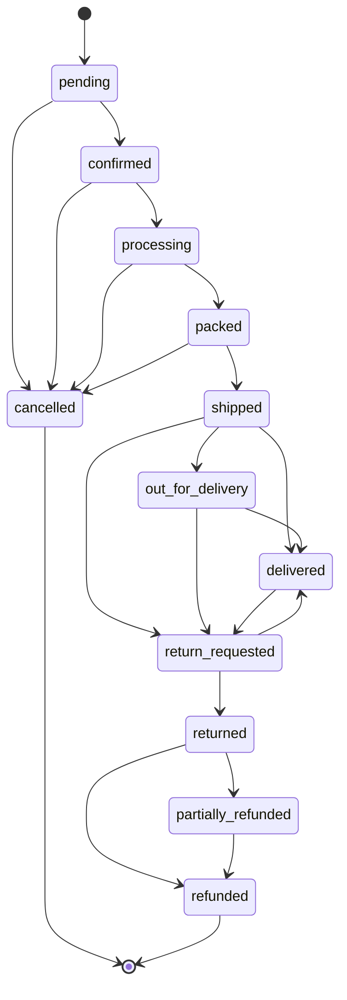

# Orders & Returns

Base path: `/api/v1/orders/`

Source: `apps/orders/{urls,views,serializers,models,services}.py`. All endpoints require `IsAuthenticated` and are scoped to `request.user` — there is no admin/staff order listing under this router (see the separate `admin-api/` app for that).

## Order status state machine

`Order.status` (`OrderStatus`) transitions are enforced strictly server-side — `apps.orders.services.transition_status()` rejects any move not listed in `ORDER_STATUS_TRANSITIONS` (`apps/orders/models.py`) with `ORDER_INVALID_TRANSITION` (409):

| From | Allowed next states |
|---|---|
| `pending` | `confirmed`, `cancelled` |
| `confirmed` | `processing`, `cancelled` |
| `processing` | `packed`, `cancelled` |
| `packed` | `shipped`, `cancelled` |
| `shipped` | `out_for_delivery`, `delivered`, `return_requested` |
| `out_for_delivery` | `delivered`, `return_requested` |
| `delivered` | `return_requested` |
| `cancelled` | *(terminal)* |
| `return_requested` | `returned`, `delivered` (rejected return reverts here) |
| `returned` | `refunded`, `partially_refunded` |
| `refunded` | *(terminal)* |
| `partially_refunded` | `refunded` |



Every transition is recorded in `OrderStatusHistory` (`from_status, to_status, changed_by, note, created_at`), which is returned as `status_history` on the order detail endpoint. `Order` also snapshots `confirmed_at`, `shipped_at`, `delivered_at`, `cancelled_at` timestamps as the corresponding transitions occur.

Orders store **immutable snapshots** of customer/address/pricing data at creation time (`shipping_address_snapshot`, `customer_*`, all totals, and each `OrderItem`'s `product_name_snapshot`/`variant_name_snapshot`/`sku_snapshot`/`unit_price`) — later edits to the product catalog, user profile, or addresses never retroactively change a placed order.

## GET /api/v1/orders/

Paginated. `OrderListSerializer`: `id, order_number, status, grand_total, currency, item_count, created_at`.

```json
{
  "success": true, "message": "Success",
  "data": {
    "results": [
      { "id": 331, "order_number": "ORD-20260814-00042", "status": "confirmed", "grand_total": "870.00", "currency": "EGP", "item_count": 2, "created_at": "2026-08-14T10:20:00Z" }
    ],
    "count": 1, "num_pages": 1, "current_page": 1, "page_size": 20, "next": null, "previous": null
  },
  "errors": null
}
```

## GET /api/v1/orders/{order_number}/

`order_number` format: `ORD-YYYYMMDD-NNNNN` (`apps.orders.services.generate_order_number`, daily-reset 5-digit sequence). `OrderDetailSerializer` — full field list: `id, order_number, status, currency, customer_name, customer_email, customer_phone, shipping_address_snapshot, shipping_method_name, payment_method, subtotal, coupon_code, coupon_discount, promotion_discount, loyalty_discount, gift_card_amount_used, store_credit_amount_used, tax_total, shipping_total, cod_fee, grand_total, notes, cancel_reason, items[], status_history[], confirmed_at, shipped_at, delivered_at, cancelled_at, created_at`. See `docs/api/checkout.md` for a full example payload (identical shape).

Errors: `ORDER_NOT_FOUND` (404, not found or not owned by the caller).

## POST /api/v1/orders/{order_number}/cancel/

Request: `{ "reason": "Changed my mind" }` (max 255 chars).

Only allowed while the order's current status has `cancelled` in its transition set — i.e. `pending`, `confirmed`, `processing`, or `packed` (see table above). Releases any active stock reservations for the order (`apps.inventory.services.release_reservation`) before transitioning to `cancelled`.

Success `200`: full `OrderDetailSerializer`, message `"Order cancelled."`

Errors: `ORDER_NOT_FOUND` (404), `ORDER_CANNOT_CANCEL` (409, order already shipped/delivered/cancelled/etc. — `Order.can_cancel()` returned false).

## Returns

Return/refund eligibility is governed by an admin-configurable singleton, `ReturnPolicySettings` (`apps/orders/models.py`), never hard-coded:
- `return_window_days` (default **14**) — days after `delivered_at` a return may still be requested
- `allow_change_of_mind_returns` (default `True`) — whether `reason=customer_change_of_mind` is accepted
- `require_approval` (default `True`) — if `False`, new return requests start at `approved` instead of `requested`

`ReturnReason` choices: `damaged | wrong_product | missing_product | expired_product | quality_issue | customer_change_of_mind`.

`ReturnRequestStatus`: `requested → approved|rejected → item_received → refunded` (or `closed`). Rejected requests revert the order back to `delivered`.

### POST /api/v1/orders/{order_number}/returns/

Request (`ReturnRequestCreateSerializer`):
```json
{
  "reason": "damaged",
  "description": "Jar arrived cracked, honey leaked.",
  "items": [ { "order_item_id": 900, "quantity": 1 } ]
}
```

Preconditions (`apps.orders.services.create_return_request`):
- Order must currently be `delivered` (otherwise `ORDER_INVALID_TRANSITION`, 409)
- `now <= delivered_at + return_window_days` (otherwise `ORDER_INVALID_TRANSITION`, 409, with a message stating the window)
- If `reason=customer_change_of_mind` and the policy disallows it, `ORDER_INVALID_TRANSITION` (409)
- Each `order_item_id` must belong to this order and `quantity` must not exceed the ordered quantity (otherwise `VALIDATION_ERROR`, 400)

On success, creates the `ReturnRequest` + `ReturnItem` rows and transitions the order to `return_requested`.

Success `201` (`ReturnRequestSerializer`):
```json
{
  "success": true, "message": "Return requested.",
  "data": {
    "id": 7, "order": 331, "reason": "damaged", "description": "Jar arrived cracked, honey leaked.",
    "status": "requested", "resolution_note": "",
    "items": [ { "order_item": 900, "quantity": 1 } ],
    "created_at": "2026-08-20T09:00:00Z"
  },
  "errors": null
}
```

Errors: `ORDER_NOT_FOUND` (404), `ORDER_INVALID_TRANSITION` (409), `VALIDATION_ERROR` (400).

### GET /api/v1/orders/returns/

Lists all of the caller's return requests across all orders (not paginated — returns a plain array), most useful for an "my returns" account page. Same `ReturnRequestSerializer` shape as above, `items[]` included via prefetch.

Note: staff-side approval/rejection (`decide_return_request`) and the receive-item-and-refund step (`complete_return_and_refund`, which calls into `apps.payments.services.create_refund`) exist in `apps/orders/services.py` but are **not exposed through this customer-facing router** — they're invoked from the admin/staff surface, not documented here.
