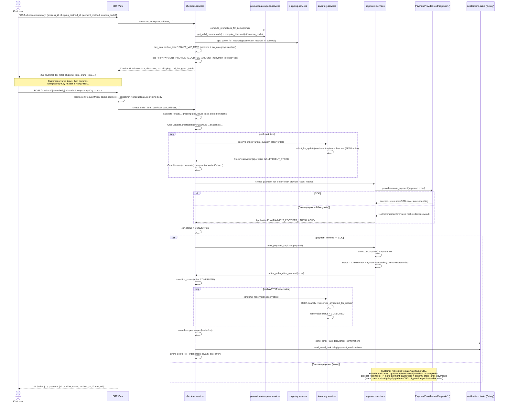

# Checkout

Checkout is orchestrated entirely server-side — the frontend never computes
totals, applies discounts, or decides payment success. This is stated
explicitly in the code: `CheckoutSummaryView`'s docstring reads "the backend,
never the frontend, computes these (spec §36)".

Relevant files:
- `apps/checkout/services.py` — `calculate_totals`, `create_order_from_cart`,
  `confirm_order_after_payment` (the three functions that do all the work)
- `apps/checkout/views.py` — `CheckoutSummaryView`, `CheckoutCreateView`
- `apps/checkout/urls.py` — `POST /checkout/summary/`, `POST /checkout/`
- `apps/inventory/services.py` — `reserve_stock` (FEFO), `consume_reservation`
- `apps/payments/services.py` — `create_payment_for_order`, `mark_payment_captured`

## Sequence



## Step-by-step detail

### 1. Totals preview — `POST /checkout/summary/`

`CheckoutSummaryView.post` (no idempotency requirement — it's read-only,
side-effect-free) calls `calculate_totals()`:

```python
# apps/checkout/services.py
def calculate_totals(*, cart, address, shipping_method_id, payment_method, coupon_code=""):
```

In order:
1. Rejects an empty cart (`ErrorCodes.CART_EMPTY`).
2. `subtotal = sum(item.line_total for item in items)`.
3. `apps.promotions.services.compute_promotions_for_items(items, currency)` —
   automatic, code-less discounts.
4. If `coupon_code` given: `apps.coupons.services.get_valid_coupon` +
   `compute_discount` — validates expiry/usage limits/minimum order amount
   and computes the coupon's discount; a `free_shipping` coupon type also
   sets `promo_free_shipping = True`.
5. `tax_total`: for each item, `tax_rate_for_product(item.variant.product)`
   returns `settings.EGYPT_VAT_RATE` (default 0.14) when
   `product.tax_category == TaxCategory.STANDARD`, else `0` — so
   zero-rated basic food and VAT-exempt items correctly contribute no tax.
   Tax is computed **per line item**, not once on the order total.
6. `shipping_total`: `apps.shipping.services.get_quote_for_method(governorate, method_id, subtotal)`,
   zeroed out if free shipping was unlocked by a promotion/coupon.
7. `cod_fee`: only when `payment_method == "cod"` — reads
   `PAYMENT_PROVIDERS["COD"]["FEE_AMOUNT"]` from settings, and raises
   `PAYMENT_PROVIDER_UNAVAILABLE` if COD is disabled
   (`PAYMENT_PROVIDERS["COD"]["ENABLED"] = False`).
8. `grand_total = discounted_subtotal + tax_total + shipping_total + cod_fee`.

The result (`CheckoutTotals` dataclass) is returned for the client to display
— nothing is written to the database yet.

### 2. Order creation — `POST /checkout/`

`CheckoutCreateView` mixes in `IdempotentRequestMixin`
(`apps/core/idempotency.py`) with `idempotency_required = True` (the
default) and `idempotency_scope = "checkout"`. A missing `Idempotency-Key`
header is rejected with `IDEMPOTENCY_KEY_REQUIRED` (400) before any business
logic runs. A retried request with the **same** key and **same** body
fingerprint (SHA-256 of the sorted JSON body) replays the cached response
instead of re-executing; the same key with a **different** body is rejected
as `IDEMPOTENCY_KEY_CONFLICT` (409); a concurrent duplicate in-flight is also
rejected as `IDEMPOTENCY_KEY_CONFLICT` (409) rather than allowed to race.

Inside the single `@transaction.atomic` block of
`create_order_from_cart()`:

1. Totals are **recomputed** server-side via `calculate_totals()` — the
   client cannot submit a tampered grand total.
2. `Order.objects.create(...)` writes the immutable snapshot: customer
   name/email/phone, `shipping_address_snapshot` (JSON, not an FK — see
   `docs/architecture/database.md`), `shipping_method_name`, all the money
   fields from `CheckoutTotals`.
3. For each cart item: `apps.inventory.services.reserve_stock(variant, quantity, order=order)`
   is called **with `order=` set** (not `cart_id=`) — this creates
   reservations without a TTL/`expires_at` (see `docs/architecture/inventory.md`
   — reservations tied to a cart during browsing expire in 30 minutes;
   reservations tied to an order do not, since the order is already
   committed) and can raise `INSUFFICIENT_STOCK`, rolling back the whole
   order. Each item also gets a corresponding `OrderItem` with its own
   product/SKU/price snapshot.
4. `PAYMENT_METHOD_PROVIDER_MAP` resolves the payment method
   (`cod`/`card`/`mobile_wallet`/`fawry_pay`/`valu`/`sympl`/`aman`) to a
   provider code (`cod`/`paymob`/`fawry`/`valu`); unmapped/unsupported
   methods raise `PAYMENT_PROVIDER_UNAVAILABLE`.
5. `apps.payments.services.create_payment_for_order(order, provider_code, method)`
   creates a `Payment` row and calls the provider's `create_payment()`. A
   `NotImplementedError` from an unconfigured gateway (Paymob/Fawry/valU) is
   caught and re-raised as `ApplicationError(PAYMENT_PROVIDER_UNAVAILABLE)` —
   the whole transaction rolls back, so no order is left dangling without a
   working payment.
6. `cart.status = CartStatus.CONVERTED`.
7. **If `payment_method == COD`**: `mark_payment_captured(payment)` is called
   *inline, synchronously, within the same request* — COD has no external
   gateway to wait for, so it can confirm immediately (see below). For a
   gateway method, the order/payment are left `PENDING` and confirmation
   happens later via webhook (`docs/architecture/payments.md`).

### 3. Order confirmation — `confirm_order_after_payment(order)`

Called by `mark_payment_captured()` (`apps/payments/services.py`) — either
synchronously for COD, or from `process_webhook()` when a gateway confirms
payment. Also wrapped in `@transaction.atomic`:

1. `transition_status(order, CONFIRMED)` if still `PENDING` (validated
   against `ORDER_STATUS_TRANSITIONS`, see `docs/architecture/database.md`
   / `apps/orders/models.py`).
2. Every `ACTIVE` `StockReservation` tied to the order is consumed
   (`apps.inventory.services.consume_reservation`) — this is where the batch
   quantity is actually permanently decremented (reservation was just a
   hold until now).
3. If a coupon was applied, `record_usage()` is called best-effort (wrapped
   in `try/except ApplicationError` — a coupon deactivated between checkout
   and confirmation must not block order confirmation).
4. Two emails are queued via Celery (`send_email_task.delay`, not sent
   inline): `order_confirmation` and `payment_confirmation`.
5. `apps.loyalty.services.award_points_for_order(order)` is called
   best-effort (`try/except ImportError`).

## Idempotency-Key mechanics

`apps.core.idempotency.IdempotentRequestMixin` (used by both
`CheckoutCreateView` and payment/refund creation endpoints) is a Redis-cache
based lock:

- `cache.add(cache_key, {"fingerprint": ..., "status": "__IN_PROGRESS__"}, ttl)`
  — atomic "set if not exists"; the TTL is `IDEMPOTENCY_KEY_TTL_SECONDS`
  (default 86400s = 24h, `config/settings/base.py`).
- If `add` fails (key already exists), the stored entry is inspected: still
  in-progress → 409 conflict; body fingerprint mismatch → 409 conflict;
  otherwise the previously-computed response is replayed verbatim.
- On success, the real response (status + body) overwrites the lock entry so
  future retries replay it instead of re-executing.
- On an unhandled exception, the lock entry is deleted so the client can
  legitimately retry with the same key.

This guarantees a customer double-tapping "Place Order" (or a client retry
after a timeout) can never create two orders or two payments for one intent.
